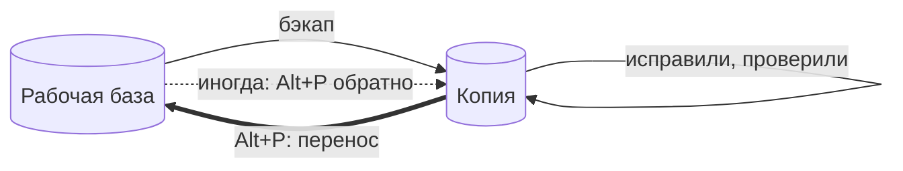
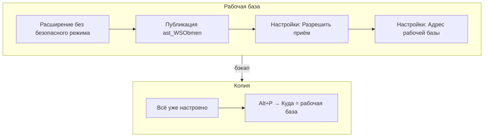
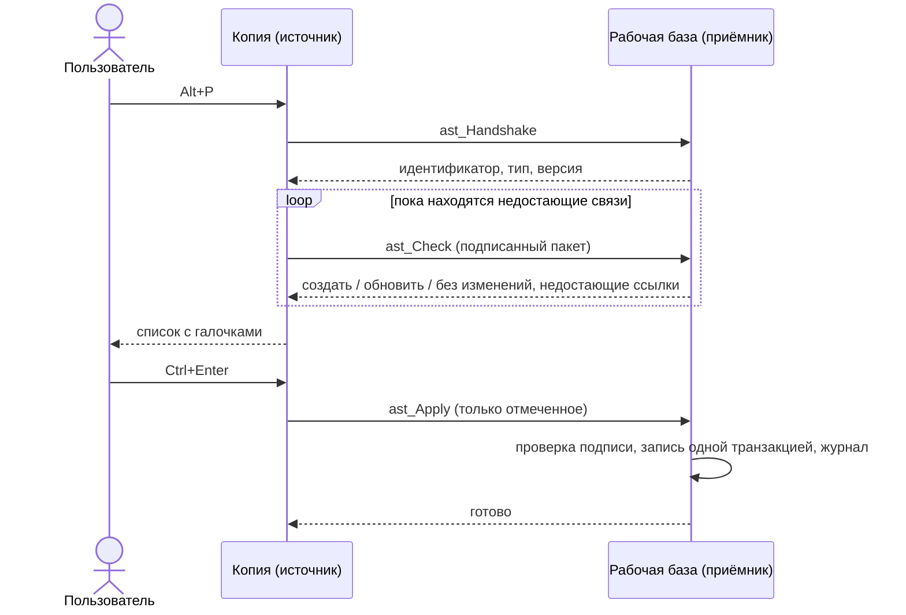
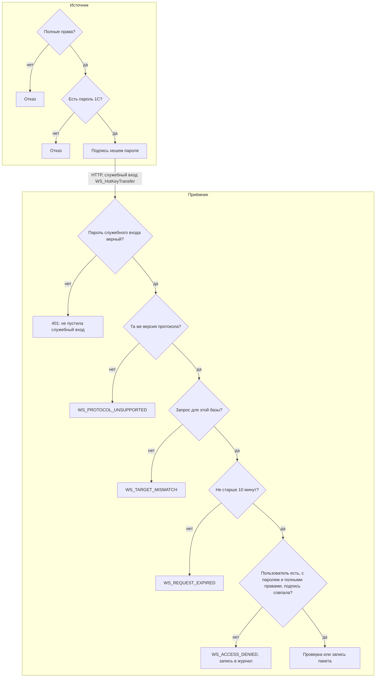

# HotKey Transfer для 1С

[](https://github.com/urasovd/ext-1C-HotKey-Transfer-public/releases/latest)
[](LICENSE)


<a href="https://infostart.ru/1c/tools/2841543/"></a>

**[Публикация расширения на Infostart](https://infostart.ru/1c/tools/2841543/)**

**Перенос справочников, документов и записей регистров из копии в рабочую базу 1С одной клавишей `Alt+P`.**

Вы поправили данные в копии, проверили, что всё работает, и теперь то же самое нужно сделать в рабочей базе. Вместо ручного повтора, выгрузки в XML или обработки «Выгрузка и загрузка данных XML» откройте объект в копии и нажмите `Alt+P`. Окно покажет, что именно изменится в рабочей базе, и после подтверждения запишет только то, что вы отметили.

**[⬇ Скачать WS_HotKeyTransfer.cfe](https://github.com/urasovd/ext-1C-HotKey-Transfer-public/releases/latest/download/WS_HotKeyTransfer.cfe)**

> Если расширение пригодилось, поставьте ⭐ репозиторию на GitHub и плюс публикации на Infostart. Так его проще найти другим, а я вижу, что расширение полезно и его стоит развивать дальше.

## Содержание

- [Для каких задач](#для-каких-задач)
- [Как это выглядит](#как-это-выглядит)
- [Установка за 10 минут](#установка-за-10-минут)
- [Примеры](#примеры)
- [Что попадает в перенос](#что-попадает-в-перенос)
- [Как устроено](#как-устроено)
- [Кто может переносить и как проверяются права](#кто-может-переносить-и-как-проверяются-права)
- [Безопасность](#безопасность)
- [Ограничения](#ограничения)
- [Если не работает](#если-не-работает)
- [Версии, сборка, лицензия](#версии)

## Для каких задач

Расширение рассчитано на привычную схему: есть **рабочая база** и одна или несколько **копий** из её бэкапа. В копии что-то исправляют или настраивают, а результат переносят в рабочую базу.



**Подходит:**

| Сценарий | Пример |
|---|---|
| Исправление справочника | В копии поправили реквизиты контрагента, договора или номенклатуры и проверили печатные формы |
| Новые элементы с зависимостями | Завели в копии статью бюджета вместе с новой группой и видом, перенесли одним действием: группа и вид найдутся сами |
| Документ с движениями | Перепровели документ в копии, проверили отчёты и перенесли документ вместе с движениями без перепроведения в рабочей базе |
| Записи регистра сведений | Настроили ставки, курсы или параметры учёта и перенесли выделенные строки регистра |
| Данные для отладки | Забрали из рабочей базы в копию несколько документов, чтобы воспроизвести ошибку |
| Обмен между копиями | Перенесли настройку из копии разработчика в копию для тестирования |

**Не подходит:**

- регулярный обмен и синхронизация: для этого есть РИБ и «Конвертация данных»;
- массовый перенос тысяч объектов или миграция между конфигурациями;
- перенос удаления: удалённый в копии объект в рабочей базе не удалится, переносится только пометка удаления;
- базы разных конфигураций.

## Как это выглядит

Окно открывается по `Alt+P` из карточки объекта или из списка:

```text
┌ Перенос: Договор № 15 от 01.03.2026 (версия 1.2.2) ───────────────────────┐
│ Куда:  https://server/base_prod                                        ▼  │
│ srv/base_dev → srv/base_prod (РАБОЧАЯ БАЗА)                               │
│ Причина: исправлен срок оплаты по письму клиента                          │
│ ☑ Создать версии объектов в приёмнике                                     │
├───────────────────────────────────────────────────────────────────────────┤
│ ☑ Договор № 15 от 01.03.2026      Будет обновлён: СрокОплаты, Комментарий │
│ ☑   Контрагент ООО «Ромашка»      Будет создан. Нужен для: Договор № 15   │
│ ☑     Банковский счёт 40702…      Будет создан. Нужен для: ООО «Ромашка»  │
│ ☐ Валюта USD                      Без изменений                           │
├───────────────────────────────────────────────────────────────────────────┤
│ Будет записано: 3     [Перенести Ctrl+Enter]  [Проверить F5]  [Настройки] │
└───────────────────────────────────────────────────────────────────────────┘
```

- **Будет обновлён** — объект есть в приёмнике и отличается от него. Перечислены отличающиеся поля, табличные части и движения.
- **Будет создан** — объекта в приёмнике нет.
- **Нужен для** — связанный объект, которого нет в приёмнике, и где он используется. Если снять с него галочку, ссылка на него в приёмнике будет битой.
- **Без изменений** — объект совпадает, галочка снята.
- Двойной щелчок по строке открывает объект этой базы, то есть то, что будет перенесено.

## Установка за 10 минут

Нужны платформа 1С:Предприятие 8.3.24 или новее (проверено на 8.3.27), одна конфигурация во всех базах и веб-сервер с публикацией.

### 1. Во всех базах, которые участвуют в обмене

1. [Скачайте `WS_HotKeyTransfer.cfe`](https://github.com/urasovd/ext-1C-HotKey-Transfer-public/releases/latest/download/WS_HotKeyTransfer.cfe).
2. «Все функции» → «Стандартные» → «Управление расширениями конфигурации» → «Добавить из файла».
3. В свойствах расширения **снимите флажок «Безопасный режим»**. Без этого платформа запретит сетевой вызов и запись.
4. Перезапустите сеанс.
5. Опубликуйте базу на веб-сервере вместе с веб-сервисом **`ast_WSObmen`**: «Администрирование» → «Публикация на веб-сервере» в конфигураторе, флажок у сервиса.

Проверка публикации: адрес `https://сервер/база/ws/ast_WSObmen?wsdl` должен открываться **с сервера 1С** другой базы и запрашивать логин.

### 2. В рабочей базе, один раз

1. Под пользователем с полными правами откройте любой объект и нажмите `Alt+P`, затем **«Настройки»**.
2. Нажмите **«Разрешить приём в эту базу»**. Будет создан служебный пользователь `WS_HotKeyTransfer` со случайным паролем.
3. Укажите **«Адрес рабочей базы»**, то есть её собственный адрес, и нажмите **«Сохранить»**. Адрес сохранится, только если по нему отвечает именно эта база.

### 3. Копии

Сделайте копию из свежего бэкапа рабочей базы. Расширение, адрес и пароль служебного входа хранятся в данных базы, поэтому копия уже настроена: в поле «Куда» сразу будет адрес рабочей базы.

Если копия сделана раньше или не из этого бэкапа, откройте в рабочей базе «Настройки» → «Показать пароль». Затем в «Настройках» копии введите этот пароль и адрес рабочей базы и нажмите «Сохранить».



Для переноса **из рабочей базы в копию** включите приём и в копии и опубликуйте её.

## Примеры

### Исправить договор и перенести его в рабочую базу

1. В копии откройте договор, исправьте срок оплаты и запишите.
2. Нажмите `Alt+P`. В поле «Куда» уже стоит рабочая база, проверка запускается сама.
3. В списке видно: «Будет обновлён: СрокОплаты». Если контрагент договора в рабочей базе ещё не заведён, он появится строкой ниже с пометкой «Нужен для».
4. Укажите причину, она попадёт в журнал регистрации рабочей базы.
5. Нажмите `Ctrl+Enter` и подтвердите.

### Перенести несколько элементов списка

1. В списке номенклатуры выделите нужные строки, например через `Ctrl`.
2. Нажмите `Alt+P`. В окне будут все выделенные строки и недостающие связанные объекты.
3. Снимите галочки с лишнего и нажмите `Ctrl+Enter`.

За один раз можно перенести до 200 элементов.

### Перенести документ с движениями

1. Исправьте и перепроведите документ в копии, проверьте отчёты.
2. В карточке документа нажмите `Alt+P`. В строке будет, например, «Будет обновлён: Товары, движения: Товары на складах».
3. После переноса документ в рабочей базе будет проведённым, а его движения совпадут с движениями в копии. Перепроводить его не нужно.

### Перенести ставки или другие записи регистра сведений

1. Откройте список регистра сведений, выделите нужные записи и нажмите `Alt+P`.
2. Если в записи есть поле-ссылка, например договор, вверху окна можно выбрать, что переносить: саму запись или объект из этого поля.

### Перенести всё, что изменили за день, по версиям объектов

Если в конфигурации включено версионирование (БСП), в копии удобно отобрать изменения через «Записи о версиях объектов».

1. Откройте список версий и отберите нужное: например, по автору и дате версии.
2. Выделите строки и нажмите `Alt+P`.
3. В поле «Что переносить» уже стоит **«Объект из поля: Объект»**: для регистров с полем «Объект» это выбор по умолчанию. Если выбрать другое, расширение запомнит выбор для этого регистра.
4. В окне будут сами документы и справочники, каждый один раз, даже если у объекта десять версий.

Сами записи версий переносить не нужно: в рабочей базе версии появятся при следующем изменении объекта.

### Забрать документ из рабочей базы в копию

1. В копии нажмите «Настройки» → «Разрешить приём в эту базу». Копия должна быть опубликована.
2. В рабочей базе откройте документ и нажмите `Alt+P`.
3. В «Куда» введите адрес копии. Направление будет выделено красным: «ИЗ РАБОЧЕЙ БАЗЫ».

## Что попадает в перенос

| Что | Как |
|---|---|
| Справочники, планы счетов, планы видов характеристик, планы видов расчёта | Объект целиком: реквизиты и табличные части |
| Документы | Объект и все его движения |
| Задачи и бизнес-процессы | Объект целиком |
| Регистры сведений | Запись по ключу; запись регистра, подчинённого регистратору, переносится всем набором регистратора |
| Связанные объекты, которых нет в приёмнике | Находятся по реквизитам, табличным частям и движениям, до 10 уровней и 200 объектов |

Объекты, которые в приёмнике уже есть, по связям не перезаписываются, даже если отличаются. Чтобы обновить такой объект, перенесите его отдельно.

Обратные связи не отслеживаются: подчинённые документы, цены, присоединённые файлы. Записи регистров, которые ссылаются на объект, переносите из списка самого регистра.

Весь пакет записывается **одной транзакцией**: при ошибке не запишется ничего.

## Как устроено



Пароль пользователя не вводится и не хранится. Запрос подписывается хешем пароля из самой базы, а приёмник сверяет подпись со своим хешем. У копии из бэкапа хеш тот же, поэтому всё работает без настройки.

Подробнее: [docs/ARCHITECTURE.md](docs/ARCHITECTURE.md).

### Какая база рабочая

Копией считается база, в имени которой есть отдельное слово `dev`, `test`, `copy`, `тест` или `копия`, в том числе с цифрами в конце.

| Имя базы | Тип |
|---|---|
| `trade_dev`, `copy01_trade`, `бух_тест`, `zup-test2` | копия |
| `trade`, `devices`, `kopeyka`, `contest_base` | рабочая |

Перенос в рабочую базу требует причины и подтверждения, перенос из неё выделяется красным. Если признак определён неверно, будет лишь лишнее подтверждение.

## Кто может переносить и как проверяются права

**Переносить может пользователь, у которого в обеих базах:**

1. одно и то же имя пользователя информационной базы;
2. один и тот же пароль 1С (вход через ОС не подходит, пустой пароль тоже);
3. полные права, то есть право «Администрирование».

В копии из бэкапа все три условия выполняются сами: пользователи и хеши паролей приходят вместе с данными. Пользователь без полных прав при попытке переноса получает отказ: «Перенос доступен только пользователям с полными правами».

**Настраивать** приём, адрес и пароль служебного входа тоже могут только пользователи с полными правами: у остальных кнопка «Настройки» не видна.

### Что проверяет каждая сторона



| Где | Что проверяется | Зачем |
|---|---|---|
| Источник | Полные права и наличие пароля 1С у текущего пользователя | Без пароля нечем подписать запрос |
| Веб-сервер приёмника | Логин и пароль служебного входа `WS_HotKeyTransfer` | Посторонний с адресом базы не получит даже ответа |
| Приёмник | Версия протокола | Базы с несовместимыми версиями не обмениваются |
| Приёмник | Идентификатор базы в запросе | Запрос, подписанный для копии, нельзя отправить в рабочую базу |
| Приёмник | Время запроса: не старше 10 минут по часам приёмника | Перехваченный запрос нельзя повторить позже |
| Приёмник | Пользователь с тем же именем, его пароль и полные права | Право на запись решает приёмник, а не источник |
| Приёмник | Подпись по хешу пароля из своей базы | Совпадает только при том же пароле; изменённое тело или операция ломают подпись |
| Приёмник | Повторная проверка пакета перед записью | Если данные изменились после проверки, ничего не запишется |
| Окно переноса | Для рабочей базы: причина и подтверждение | Защита от случайного переноса |

Подпись считается так:

```text
SHA256( хеш пароля пользователя | операция | имя пользователя | база-приёмник | время | SHA256(тело запроса) )
```

Операция входит в подпись, поэтому запрос на проверку нельзя превратить в запрос на запись. Сам пароль и его хеш по сети не передаются.

### Под кем идёт запись

Запрос приходит под служебным пользователем, у которого нет прав на данные. После всех проверок приёмник записывает пакет в привилегированном режиме. Поэтому в журнале регистрации пользователем записи будет `WS_HotKeyTransfer`. Настоящий автор, база-источник, причина и состав указаны в комментарии к событию `WS_HotKeyTransfer.Receive`. Отклонённые запросы тоже попадают в журнал, с уровнем «Предупреждение».

Чтобы найти, кто и что переносил: журнал регистрации приёмника → отбор по событию `WS_HotKeyTransfer.Receive`.

### Версии объектов

Если в приёмнике включено версионирование (БСП), у перенесённых объектов создаётся версия. **Автором версии будет настоящий пользователь**, а не служебный вход, в комментарии будут база-источник, пользователь и причина. Их видно в «Истории изменений» объекта, и там же можно сравнить версии или вернуться к предыдущей.

Флажок «Создать версии объектов в приёмнике» в окне переноса позволяет перенести без версий, например при технической правке. Выбор запоминается. Запись в журнал регистрации делается в любом случае.

Версия создаётся только для видов объектов, у которых в приёмнике включено версионирование. Если у объекта до переноса не было версий, история начнётся с перенесённого состояния. Приёмник версии ниже 1.3.0 флажок не учитывает.

## Безопасность

Схема рассчитана на доверие между рабочей базой и её копиями. Её ограничения известны заранее:

- **Доверие к копиям.** Администратор любой копии или тот, у кого есть бэкап, может получить хеш пароля и записать данные в рабочую базу от имени этого пользователя. Если копиям доверять нельзя, не включайте приём в рабочей базе.
- **Служебный вход.** Пароль пользователя `WS_HotKeyTransfer` хранится в данных базы в открытом виде, потому что он нужен отправляющей стороне. Этот пользователь не может открыть базу клиентом или внешним соединением, ему доступны только операции веб-сервиса, и без верной подписи они ничего не записывают.
- **Режим записи.** Данные пишутся в привилегированном режиме с `ОбменДанными.Загрузка = Истина`. Обработчики записи и проверки конфигурации не выполняются, поэтому даты запрета изменения могут не сработать.
- **Журнал.** Каждый перенос записывается в журнал регистрации приёмника, событие `WS_HotKeyTransfer.Receive`: пользователь, источник, причина и состав.
- **https.** По `http` данные и пароль служебного входа передаются открыто. Для рабочей базы используйте `https`.
- **Отключение.** Чтобы выключить приём, удалите пользователя `WS_HotKeyTransfer`.

## Ограничения

- Пользователи с входом только через ОС или без пароля 1С переносить не могут.
- Если пароль пользователя в рабочей базе сменили после создания копии, перенос будет отклонён, пока пароли не совпадут.
- Удаление объектов не переносится.
- Несовместимый по составу данных элемент блокируется при проверке.
- Расширение не меняет объекты конфигурации и не добавляет своих справочников, регистров и констант.

## Если не работает

| Сообщение | Что проверить |
|---|---|
| «Не пустила служебный вход» | В приёмнике не включён приём, или пароли служебного входа различаются. Возьмите пароль в «Настройках» одной базы кнопкой «Показать пароль» и введите в другой. |
| «Не пустила служебный вход», хотя раньше работало | В «Настройках» приёмника строка «Приём данных» покажет причину, например вход выключен БСП как неактивному. Нажмите «Разрешить приём в эту базу». С версии 1.2.3 служебный вход от этого защищён. |
| «Приём данных: требует исправления…» | Нажмите «Разрешить приём в эту базу» в «Настройках». |
| Ошибка соединения или код 404 | Неверный адрес, или `ast_WSObmen` не опубликован. Адрес должен открываться с сервера 1С. |
| Код 402 | Сеанс служебного пользователя не открылся. Проверьте сообщение выше и журнал регистрации приёмника по пользователю `WS_HotKeyTransfer`. |
| «Другая конфигурация» | Перенос возможен только между базами одной конфигурации. |
| «Версии расширения несовместимы» | Обновите расширение во всех базах. |
| «Перенос запрещён: пользователь…» | Имя, пароль или полные права пользователя в базах различаются. |
| «В этой базе нет пароля служебного входа» | Введите пароль в «Настройках» или обновите копию из свежего бэкапа. |

Не нашли ответа? [Создайте issue](https://github.com/urasovd/ext-1C-HotKey-Transfer-public/issues) с текстом сообщения и версией расширения.

## Версии

Номер версии: `первая.вторая.третья`. Первая цифра растёт при изменении протокола, тогда обновить расширение нужно во всех базах одновременно. Вторая растёт с новой возможностью, третья с исправлением. Версия видна в заголовке окна и в «Настройках». История изменений: [CHANGELOG.md](CHANGELOG.md). Планы: [docs/ROADMAP.md](docs/ROADMAP.md).

## Сборка из исходников

```text
src/cfe/WS_HotKeyTransfer/   исходники расширения (выгрузка конфигуратора в XML)
tests/integration/           интеграционный тест на двух тестовых базах
docs/                        устройство, проверки, планы
```

Загрузите исходники в тестовую базу и выгрузите расширение в файл:

```text
1cv8 DESIGNER /S сервер\база /LoadConfigFromFiles src\cfe\WS_HotKeyTransfer -Extension WS_HotKeyTransfer /UpdateDBCfg
1cv8 DESIGNER /S сервер\база /DumpCfg WS_HotKeyTransfer.cfe -Extension WS_HotKeyTransfer
```

Проверки и интеграционный тест: [docs/TEST_PLAN.md](docs/TEST_PLAN.md).

## Лицензия

[MIT](LICENSE): можно свободно использовать, изменять и распространять, в том числе в коммерческих базах.

Если расширение сэкономило вам время, поставьте ⭐ на GitHub и плюс публикации на Infostart.
